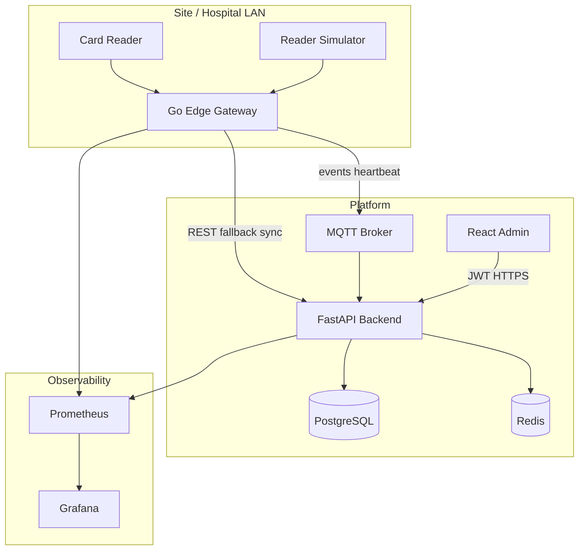

# Hospital Cafeteria System

<p align="center">
  <strong>Card-based meal access · Edge offline cache · Multi-tenant SaaS-ready</strong>
</p>

<p align="center">
  <a href="https://go.dev/"></a>
  <a href="https://fastapi.tiangolo.com/"></a>
  <a href="https://react.dev/"></a>
  <a href="https://www.typescriptlang.org/"></a>
  <a href="https://www.postgresql.org/"></a>
  <a href="https://redis.io/"></a>
  <a href="https://mqtt.org/"></a>
  <a href="https://www.docker.com/"></a>
  <a href="https://prometheus.io/"></a>
  <a href="https://grafana.com/"></a>
</p>

<p align="center">
  <a href="#quick-start-docker">Quick start</a> ·
  <a href="#architecture">Architecture</a> ·
  <a href="#urls">URLs</a> ·
  <a href="#api-overview-mvp">API</a> ·
  <a href="proje.md">Domain spec (TR)</a>
</p>

---

Card-reader access control, meal entitlement checks, device fleet monitoring, and an admin dashboard for hospital cafeterias. Monorepo oriented toward multi-tenant cloud/SaaS deployment.

> **Domain & compliance (Turkish):** [`proje.md`](./proje.md) — Panates integration, KVKK, pilot scope.

## Architecture



| Step | What happens |
|:----:|----------------|
| 1 | Reader or simulator sends card UID to edge (TCP JSON lines). |
| 2 | Edge pre-checks local cache; publishes event over MQTT. |
| 3 | Backend validates entitlements, meal window, Redis duplicate-meal lock. |
| 4 | MQTT down → disk queue + `POST /access/validate`. |
| 5 | Admin UI shows heartbeats and transactions (auto-refresh). |

MQTT topics: [`docs/adr/001-mqtt-topics.md`](./docs/adr/001-mqtt-topics.md)

---

## Tech stack

<table>
<tr>
  <td align="center" width="120"><br/><b>Go</b><br/>Edge gateway</td>
  <td align="center" width="120"><br/><b>FastAPI</b><br/>REST + MQTT worker</td>
  <td align="center" width="120"><br/><b>React</b><br/>Admin UI</td>
  <td align="center" width="120"><br/><b>PostgreSQL</b><br/>Primary DB</td>
  <td align="center" width="120"><br/><b>Redis</b><br/>Locks / cache</td>
</tr>
<tr>
  <td align="center"><br/><b>Mosquitto</b><br/>MQTT</td>
  <td align="center"><br/><b>Docker</b><br/>Compose</td>
  <td align="center"><br/><b>Prometheus</b><br/>Metrics</td>
  <td align="center"><br/><b>Grafana</b><br/>Dashboards</td>
  <td align="center"><br/><b>Actions</b><br/>CI / deploy</td>
</tr>
</table>

| Layer | Components |
|--------|------------|
| **Edge** | Go 1.22, SQLite cache, offline queue, Prometheus |
| **API** | Python 3.12, SQLAlchemy 2, Alembic, aiomqtt |
| **Frontend** | Vite, Tailwind CSS, JWT auth |
| **Ops** | TR VPS deploy profile, KVKK-oriented hosting notes in `proje.md` |

---

## Requirements

- [Docker Desktop](https://www.docker.com/products/docker-desktop/) (Windows/macOS) or Docker Engine + Compose v2
- Optional local dev: Python 3.12+, Node.js 20+, Go 1.22+

---

## Quick start (Docker)

From the repository root:

**Windows (cmd):**

```bat
copy .env.example .env
docker compose up -d --build
```

**Windows (PowerShell):**

```powershell
Copy-Item .env.example .env
docker compose up -d --build
```

**Simulate card reads:**

```bat
docker compose --profile edge up -d --build edge-gateway reader-simulator
```

<details>
<summary><b>Verify & logs</b></summary>

```bat
docker compose ps
docker compose logs api --tail 50
docker compose logs edge-gateway --tail 50
```

</details>

---

## URLs

| Service | URL | Description |
|--------|-----|-------------|
| **Admin UI** | http://localhost:3000 | Devices & live access log |
| **API** | http://localhost:8000 | REST backend |
| **Swagger** | http://localhost:8000/docs | Try endpoints |
| **Health** | http://localhost:8000/health | Liveness |
| **Grafana** | http://localhost:3001 | Dashboards |
| **Prometheus** | http://localhost:9090 | Metrics explorer |
| **MQTT** | `localhost:1883` | Dev broker (anonymous) |

---

## Demo credentials and seed data

From migration `002_seed_demo`:

| Item | Value |
|------|--------|
| Admin login | `admin@demo.local` / `admin123` |
| Tenant UUID | `00000000-0000-0000-0000-000000000001` |
| Device keys | `reader-giris-1`, `reader-giris-2` |
| Device API key | `dev_device_key_change_me` (`.env` → `EDGE_DEVICE_API_KEY`) |
| Test card UIDs | `A1B2C3D4`, `E5F6G7H8` |
| Demo entitlements | **Lunch** 11:30–14:30, monthly quota |

Outside the lunch window you may see `RED_HAK_YOK` or similar; that is expected.

**Manual access test (Swagger):** `POST /access/validate`

```json
{
  "card_uid": "A1B2C3D4",
  "device_key": "reader-giris-1"
}
```

Header: `X-Device-Api-Key: dev_device_key_change_me`

---

## Repository layout

```
├── backend/              # FastAPI, Alembic, MQTT consumer
├── edge-gateway/         # Go edge service
├── frontend/             # React admin UI
├── tools/
│   └── reader-simulator/ # TCP card-read simulator
├── infra/                # Mosquitto, Prometheus, Grafana
├── docs/adr/             # Architecture decision records
├── .github/workflows/    # CI and production deploy
├── docker-compose.yml
├── docker-compose.prod.yml
├── proje.md              # Detailed domain spec (Turkish)
└── .env.example
```

---

## Environment variables

Copy `.env.example` to `.env`. **Change these in production:**

- `POSTGRES_PASSWORD`
- `JWT_SECRET`
- `API_INTERNAL_KEY`
- `EDGE_DEVICE_API_KEY`
- `GRAFANA_ADMIN_PASSWORD`

`VITE_API_URL` is the API URL as seen by the browser (typically `http://localhost:8000` with Docker).

---

## Local development (without Docker)

### Backend

```bat
cd backend
python -m venv .venv
.venv\Scripts\activate
pip install -r requirements.txt
alembic upgrade head
uvicorn app.main:app --reload --port 8000
pytest
ruff check app tests
```

PostgreSQL and Redis must be running (`DATABASE_URL`, `REDIS_URL`).

### Frontend

```bat
cd frontend
npm install
npm run dev
```

http://localhost:5173 — ensure `CORS_ORIGINS` in `.env` includes `http://localhost:5173`.

### Edge gateway

```bat
cd edge-gateway
go mod tidy
go run ./cmd/gateway
```

---

## API overview (MVP)

| Method | Path | Description |
|--------|------|-------------|
| POST | `/auth/login` | Admin JWT |
| POST | `/access/validate` | Access decision (device API key) |
| GET | `/devices` | Device list (JWT) |
| POST | `/devices/heartbeat` | Heartbeat (REST fallback) |
| GET | `/internal/edge/v1/sync` | Edge offline cache sync |
| GET | `/reports/transactions/recent` | Recent transactions |
| GET | `/reports/summary/today` | Today’s summary |
| GET | `/metrics` | Prometheus metrics |

Roles: `super_admin`, `tenant_admin`, `yemekhane`, `read_only`.

---

## CI/CD

- **`.github/workflows/ci.yml`**: backend (ruff, pytest), edge (Go build), frontend (lint, build), Docker build.
- **`.github/workflows/deploy.yml`**: GitHub Environment `production-tr` with `VPS_HOST`, `VPS_USER`, `SSH_KEY`; remote `docker compose` using prod overrides.

Example server path: `/opt/yemekhane`. Production secrets in `.env.production` → `.env` on the server (**never commit**).

Production hosting targets **Turkey-based** infrastructure for KVKK (personal data law); see `proje.md` §7.

---

## Security

- `.env` is gitignored; do not commit secrets.
- Dev MQTT allows anonymous clients; use TLS and authentication in production.
- National ID (TC) is not collected in the MVP (data minimization).
- Device ↔ cloud: `X-Device-Api-Key` plus hospital VLAN / IP restrictions recommended.

---

## Roadmap (not in repo yet)

- Panates read-only staff sync
- Companion / intern workflows
- Card and user CRUD in admin UI
- PostgreSQL RLS for tenant isolation
- MQTT TLS, HTTPS via Caddy/Traefik
- E-invoicing / SaaS billing automation

---

## First push to GitHub

Use a **private** repository if the project is commercial. Do not commit `.env`.

```bat
git init
git add .
git status
git commit -m "Initial commit: cafeteria monorepo MVP"
git branch -M main
git remote add origin https://github.com/YOUR_ORG/YOUR_REPO.git
git push -u origin main
```

---

## License

Not specified yet. For commercial use, prefer a private repository and an explicit license.

---

## Contributing

Intended for internal team use. Enable Issues/PRs in GitHub repository settings as needed.
